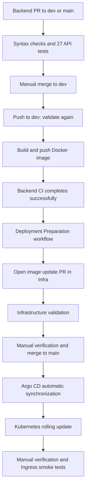

# Pipeline360 Backend

## Overview

Pipeline360 Backend is the REST API of the Pipeline360 cloud-native hotel reservation platform.

The application is implemented using Node.js and Express and is responsible for all business logic, reservation management, hotel management and communication with MongoDB.

The backend exposes a RESTful API consumed by the Pipeline360 Frontend through Kubernetes Services and Ingress.

This repository is responsible for:

- Backend source code
- REST API
- Database communication
- Docker image
- Backend CI/CD pipelines

The complete platform architecture, Kubernetes manifests, GitOps workflow and Argo CD configuration are documented in the **Pipeline360-Infra** repository.

---

## Related Repositories

| Repository | Responsibility |
|------------|----------------|
| Pipeline360-Frontend | Frontend application and frontend CI/CD |
| Pipeline360-Backend | REST API, business logic and backend CI/CD |
| Pipeline360-Infra | Kubernetes manifests, Argo CD, GitOps deployment and complete project documentation |

---

## Features

The backend provides the following capabilities:

- Retrieve available hotels
- Create reservations
- Generate unique reservation IDs
- Search reservations
- Cancel reservations
- Validate reservation requests
- Store application data in MongoDB
- Expose health and readiness endpoints

---

## Technology Stack

| Area | Technology |
|------|------------|
| Runtime | Node.js |
| Framework | Express |
| Database | MongoDB |
| ODM | Mongoose |
| Containerization | Docker |
| Container Registry | Docker Hub |
| CI/CD | GitHub Actions |
| Deployment | Kubernetes |
| GitOps | Argo CD |

---

## Repository Structure

```text
Pipeline360-Backend/
│
├── .github/
│   └── workflows/
│       ├── ci.yaml
│       └── deployment-preparation.yaml
│
├── src/
│   ├── config/
│   ├── controllers/
│   ├── models/
│   ├── routes/
│   └── server.js
│
├── Dockerfile
├── package.json
├── package-lock.json
└── README.md
```

---

# REST API

The backend exposes the following REST endpoints.

---

## Health Endpoint

```text
GET /health
```

Response

```json
{
  "status": "healthy"
}
```

Purpose:

- Kubernetes liveness probe
- Health monitoring

---

## Readiness Endpoint

```text
GET /ready
```

Response

```json
{
  "status": "ready",
  "database": "connected"
}
```

Purpose:

- Kubernetes readiness probe
- Database connectivity verification

---

## Hotels

```text
GET /api/reservations/hotels
```

Returns all available hotels stored in MongoDB.

---

## Create Reservation

```text
POST /api/reservations
```

Example request

```json
{
  "fullName": "John Doe",
  "email": "john@example.com",
  "hotelId": "hotel_001",
  "checkIn": "2030-06-10",
  "checkOut": "2030-06-12"
}
```

Example response

```json
{
  "reservationId": "R-123456"
}
```

---

## Lookup Reservation

```text
GET /api/reservations/lookup/{query}
```

Supported lookup values:

- Reservation ID
- Full name
- Email address

---

## Cancel Reservation

```text
DELETE /api/reservations/{reservationId}
```

Removes the reservation from MongoDB.

---

## Validation Rules

Every reservation request is validated before being stored.

Validation includes:

- Required fields
- Valid email address
- Existing hotel
- Valid check-in date
- Valid check-out date
- Check-out after check-in
- Reservation availability
- Unique reservation identifier

---

## MongoDB Collections

The backend uses two collections.

### hotels

Stores hotel information.

Typical fields include:

- Hotel name
- Location
- Description

---

### reservations

Stores reservation information.

Typical fields include:

- Reservation ID
- Customer name
- Email
- Hotel
- Check-in date
- Check-out date


---

## Environment Variables

The backend uses the following environment variables:

| Variable | Purpose | Default |
|---|---|---|
| `PORT` | HTTP port used by the Express server | `3000` |
| `MONGO_URL` | MongoDB connection string | Local fallback defined by the application |

In Kubernetes, `MONGO_URL` is provided by the `app-config` ConfigMap in the `Pipeline360-Infra` repository.

Example:

```text
mongodb://mongo-0.mongo-headless.hotel-system.svc.cluster.local:27017,
mongo-1.mongo-headless.hotel-system.svc.cluster.local:27017,
mongo-2.mongo-headless.hotel-system.svc.cluster.local:27017/
?replicaSet=rs0&readPreference=primary
```

> [!IMPORTANT]
> MongoDB internal authentication is not enabled in the current local Kind environment.
> Real credentials must never be committed to the repository.

---

## Local Validation

Install dependencies:

```bash
npm ci
```

Run backend validation:

```bash
npm test
```

Start the application locally:

```bash
npm start
```

The backend listens on:

```text
http://127.0.0.1:3000
```

Check the health endpoint:

```bash
curl http://127.0.0.1:3000/health
```

Check the readiness endpoint:

```bash
curl http://127.0.0.1:3000/ready
```

> [!NOTE]
> The readiness endpoint returns a successful response only when MongoDB is connected.

---

## Docker Image

The backend Docker image is published automatically by GitHub Actions.

Docker Hub repository:

```text
eli0504167101/hotel-backend
```

Published tags:

```text
backend-N
latest
```

Where:

- `backend-N` is a versioned tag generated from the GitHub Actions workflow run number. The workflow does not enforce tag immutability; re-running a build can overwrite the same tag.
- `latest` is updated by each successful image push; concurrent or repeated runs can change which build it references.

Kubernetes deploys the numbered image tag rather than `latest`. The manifest references a tag, not an image digest.

Example:

```text
eli0504167101/hotel-backend:backend-12
```

Build the image locally:

```bash
docker build \
  -t pipeline360-backend:local .
```

Run the container locally:

```bash
docker run \
  --rm \
  -p 3000:3000 \
  -e PORT=3000 \
  -e MONGO_URL="mongodb://host.docker.internal:27017/Pipeline360_PROD" \
  pipeline360-backend:local
```

> [!NOTE]
> The MongoDB address used for local Docker execution depends on the local environment.

---

## CI/CD and GitOps Workflow

Pipeline360 separates application delivery from infrastructure deployment. GitHub Actions validates the backend and publishes Docker images, while Argo CD reconciles the Kubernetes cluster with the desired state stored in the infrastructure repository.

### Delivery Flow



### 1. Pull Request Validation

The `Backend CI` workflow, defined in `.github/workflows/ci.yaml`, runs for pull requests targeting `dev` or `main`.

The `validate` job installs dependencies with `npm ci`, runs `npm test`, verifies required project files, and uploads build metadata.

Pull request runs do not build or publish Docker images. Image publishing is restricted to successful validation runs triggered by a push to `dev`.

### 2. Automated API Tests

The test suite contains 27 tests implemented with Node.js `node:test` and `supertest`.

Tests send HTTP requests through the actual Express middleware, routes, and controllers. Mongoose operations are mocked, so the suite requires no running MongoDB instance or database credentials.

Coverage includes:

- Health and readiness responses.
- Hotel listing and reservation lookup.
- Reservation creation and cancellation.
- Required fields, email validation, and invalid dates.
- Missing hotels, overlapping reservations, duplicate keys, and database failures.

The Express application is exported from `src/app.js`; production startup and database connection logic remain in `src/server.js`. Mocks are restored between tests, and HTTP requests have timeouts.

These tests validate API behavior without verifying persistence or query execution against a real database.

### 3. Docker Image Build and Push

A push to `dev` runs validation again. After validation succeeds, `build-and-push` uses Docker Buildx to build and publish:

```text
eli0504167101/hotel-backend:backend-<workflow-run-number>
eli0504167101/hotel-backend:latest
```

Kubernetes manifests use the numbered tag. For example, Backend CI run number 19 published `backend-19`.

The numbered tag provides release traceability, but the current workflow does not enforce tag immutability or pin deployments by image digest.

Pushes containing only changes to `README.md`, `docs/**`, or `LICENSE` do not trigger this pipeline.

### 4. Deployment Preparation Pull Request

`.github/workflows/deployment-preparation.yaml` listens for completion of `Backend CI`. Its update job runs only when the source workflow:

- Completed successfully.
- Was triggered by a `push`.
- Ran on branch `dev`.

The workflow checks out `Pipeline360-Infra/main`, updates the image reference in `kubernetes/backend/deployment.yaml`, and opens a pull request from:

```text
deployment/backend-<source-run-id>
```

The PR records the image tag, source commit, and CI run URL. Infrastructure validation checks the proposed manifests before merge.

### 5. Manual Approval and GitOps Deployment

The delivery process uses manual review and merge of the infrastructure PR as the release approval step. The automation does not merge the PR.

Required reviews are not currently enforced by branch protection or rulesets; approval is an operational practice.

The Argo CD application `pipeline360-backend` is configured with:

```yaml
repoURL: https://github.com/eli0504167101/Pipeline360-Infra.git
targetRevision: main
path: kubernetes/backend
```

Automatic synchronization, pruning, and self-healing are enabled. After the infrastructure PR is merged, Argo CD detects the desired-state change and applies it to namespace `hotel-system`. GitHub Actions does not run a direct Kubernetes deployment command.

### 6. Kubernetes Rolling Update and Verification

The backend Deployment declares five replicas. Updating its image triggers Kubernetes’ default `RollingUpdate` strategy, gradually replacing the previous Pods.

The application exposes `/health` for liveness and `/ready` for readiness, including MongoDB connection status.

Post-deployment verification checks:

- Argo CD is `Synced` and `Healthy` at the expected Git revision.
- All five backend replicas are updated, available, and ready.
- Every backend Pod uses the intended image.
- The rolling update has completed.

Smoke tests are performed manually through the existing Ingress access path in the local environment:

| Endpoint | Expected result |
|---|---|
| `http://hotel.local:3000/api/reservations/hotels` | HTTP 200 and a valid JSON array |
| `http://hotel.local:3000` | HTTP 200 and the frontend HTML document |

The Ingress routes `/api` to `backend-service:3000` and `/` to `frontend-service:80`. Port `3000` in these URLs is part of the local access setup, rather than a port declared by the Ingress resource.

For the `backend-19` release, both smoke checks passed, and all five backend Pods were running and ready.

---

# GitHub Actions

The backend repository implements **two separate GitHub Actions workflows**, with deployment preparation triggered by completion of Backend CI.

The deployment preparation workflow listens for Backend CI completion. Its infrastructure update job runs only after a successful CI run triggered by a push to `dev`.

---

## Pipeline 1 — Backend CI

Workflow:

```text
.github/workflows/ci.yaml
```

Triggers:

- Push to `dev`, excluding changes limited to `README.md`, `docs/**`, and `LICENSE`.
- Pull requests targeting `dev` or `main`.
- Manual execution through `workflow_dispatch`.

Validation runs for all these events. Docker image build and push run only after successful validation for a push to `dev`; pull request and manual runs perform validation only.

Responsibilities:

- Check out the backend source code
- Install dependencies
- Validate the Node.js application
- Verify required repository files
- Build the Docker image
- Authenticate to Docker Hub
- Push versioned and latest image tags

Published tags:

```text
backend-N
latest
```

Publishing flow for a qualifying push to `dev`:

```text
Developer
      │
      ▼
Push to dev
      │
      ▼
Validate Backend
      │
      ▼
Install Dependencies
      │
      ▼
Run Tests
      │
      ▼
Build Docker Image
      │
      ▼
Push backend-N
      │
      ▼
Push latest
```

For a qualifying push to `dev`, the build job publishes the image before the workflow finishes its remaining cleanup steps. Deployment preparation depends on completion of the entire Backend CI run.

---

## Pipeline 2 — Backend Deployment Preparation

Workflow:

```text
.github/workflows/deployment-preparation.yaml
```

Trigger:

```text
Backend CI completes (workflow_run: completed)
```

The `update-infra` job runs only when:

- Backend CI completed successfully
- The source branch was `dev`
- The source event was a push

Responsibilities:

1. Read the completed Backend CI workflow metadata.

2. Generate the matching Docker image tag.

Example:

```text
backend-12
```

3. Check out the Infrastructure repository:

```text
Pipeline360-Infra/main
```

4. Validate the Backend Deployment manifest.

5. Update only:

```text
kubernetes/backend/deployment.yaml
```

6. Create a deployment branch.

Example:

```text
deployment/backend-123456789
```

7. Commit the updated Backend image reference.

8. Push the deployment branch to `Pipeline360-Infra`.

9. Open a Pull Request to:

```text
Pipeline360-Infra/main
```

The workflow never pushes deployment changes directly to `main`.

The intended release process is manual verification and merge of the Pull Request into `main`. The workflow does not merge it automatically. Required reviews are not currently enforced by branch protection or rulesets.

---

## Complete Backend Delivery Flow

```text
Developer
      │
      ▼
Push to Backend/dev
      │
      ▼
──────────────────────────────
Pipeline 1
Backend CI
──────────────────────────────
      │
      ▼
Validate
      │
      ▼
Build Docker Image
      │
      ▼
Push backend-N
      │
      ▼
──────────────────────────────
Pipeline 2
Backend Deployment Preparation
──────────────────────────────
      │
      ▼
Update Pipeline360-Infra
      │
      ▼
Create Deployment Branch
      │
      ▼
Open Pull Request
      │
      ▼
Review and Approval
      │
      ▼
Merge to main
      │
      ▼
Argo CD detects manifest change
      │
      ▼
Kubernetes RollingUpdate
      │
      ▼
5 Ready Backend Pods
```

---

## Required GitHub Actions Secrets

The repository requires the following GitHub Secrets:

| Secret | Purpose |
|---|---|
| `DOCKERHUB_USERNAME` | Docker Hub account used for image naming |
| `DOCKERHUB_TOKEN` | Authenticate and push images to Docker Hub |
| `INFRA_REPO_TOKEN` | Create deployment branches and Pull Requests in Pipeline360-Infra |

> [!WARNING]
> Never commit passwords, Docker Hub tokens, Personal Access Tokens, `.env` files or decoded Kubernetes Secret values.

---

## GitOps Responsibility

This repository is responsible for:

- Backend source code
- Backend validation
- Docker image creation
- Docker Hub publishing
- Preparing the Backend manifest update

This repository is **not** the Kubernetes deployment source of truth.

The desired Kubernetes state is maintained in:

```text
Pipeline360-Infra
```

Argo CD synchronizes Backend manifests from Infrastructure `main`. The intended workflow updates that branch by manually verifying and merging the Infrastructure Pull Request; Argo CD does not check PR review or approval status.

---

# Kubernetes Deployment

The backend Kubernetes manifests are maintained in the **Pipeline360-Infra** repository.

Manifest location:

```text
kubernetes/backend/
```

Files:

```text
deployment.yaml
service.yaml
```

The Backend repository never deploys directly to Kubernetes.

Instead, it updates the Infrastructure repository through an automated Pull Request following the GitOps deployment model.

---

## Deployment Configuration

Current deployment configuration:

| Resource | Value |
|----------|-------|
| Deployment | backend-deployment |
| Namespace | hotel-system |
| Replicas | 5 |
| Service | backend-service |
| Service Port | 3000 |
| Container Port | 3000 |

---

## Health Monitoring

The Backend exposes two endpoints used by Kubernetes.

### Liveness Probe

```text
GET /health
```

Purpose:

- Verify the application process is running
- Automatically restart unhealthy containers

---

### Readiness Probe

```text
GET /ready
```

Purpose:

- Verify MongoDB connectivity
- Prevent traffic from reaching Pods that are not ready

Only Pods that successfully pass the readiness probe receive application traffic.

---

# Argo CD

Backend deployment is managed through Argo CD.

Application:

```text
pipeline360-backend
```

Repository:

```text
Pipeline360-Infra
```

Branch:

```text
main
```

Managed path:

```text
kubernetes/backend
```

Argo CD continuously monitors the Infrastructure repository.

Whenever a new Backend image tag is merged into the deployment manifest, Argo CD synchronizes the Kubernetes cluster automatically.

---

## GitOps Deployment Model

Pipeline360 follows a GitOps deployment strategy.

Deployment occurs in two stages:

1. Build and publish a Docker image.
2. Update the Infrastructure repository.

The intended release process is to verify the Infrastructure Pull Request and merge it into `main`. Argo CD automatically synchronizes changes from that branch. Review and approval are operational practices, not technically enforced prerequisites in the current repository configuration.

Git records the manifest changes and provides a reviewable history linking image updates to source commits and workflow runs.

Byte-for-byte reproducible builds are not guaranteed. Although `npm ci` uses the dependency lockfile, the Dockerfile uses the mutable `node:20-alpine` base tag and upgrades Alpine packages during the build. Deployment manifests also reference numbered image tags rather than immutable digests.

---

## Rolling Update Strategy

Backend deployments use the Kubernetes RollingUpdate strategy.

The configuration supports gradual Pod replacement and readiness-based traffic routing. Liveness probe failures can trigger container restarts; they do not automatically roll back a release.

The manifest does not override the default rolling update limits. With five desired replicas, the default 25% limits allow one unavailable replica and two additional replicas during rollout. This supports availability during updates but does not guarantee zero downtime or uninterrupted requests; successful rollout also depends on application behavior, image availability, database connectivity, and cluster capacity.

Deployment process:

```text
5 Running Pods
      │
      ▼
Create New Pod
      │
      ▼
Readiness Probe
      │
      ▼
Route Traffic
      │
      ▼
Terminate Old Pod
      │
      ▼
Repeat Until Complete
```

---

# Verification

Verify the Argo CD Application:

```bash
kubectl get application pipeline360-backend \
    -n argocd \
    -o custom-columns='SYNC:.status.sync.status,HEALTH:.status.health.status,REVISION:.status.sync.revision'
```

Expected:

```text
Synced
Healthy
```

---

Verify the Deployment:

```bash
kubectl get deployment backend-deployment \
    -n hotel-system
```

---

Verify the running Pods:

```bash
kubectl get pods \
    -n hotel-system \
    -l app=backend
```

Expected:

```text
READY   STATUS
1/1     Running
```

---

Verify the active Docker image:

```bash
kubectl get deployment backend-deployment \
    -n hotel-system \
    -o jsonpath='{.spec.template.spec.containers[0].image}{"\n"}'
```

Example:

```text
eli0504167101/hotel-backend:backend-14
```

---

Monitor the rollout:

```bash
kubectl rollout status \
    deployment/backend-deployment \
    -n hotel-system \
    --timeout=180s
```

> [!NOTE]
> This command monitors an existing rollout.
> It does not initiate a deployment.

---

## API Verification

Verify the health endpoint:

```bash
curl http://127.0.0.1:3000/health
```

Expected:

```json
{
  "status": "healthy"
}
```

---

Verify the readiness endpoint:

```bash
curl http://127.0.0.1:3000/ready
```

Expected:

```json
{
  "status": "ready",
  "database": "connected"
}
```

---

Verify the Hotels endpoint:

```bash
curl http://127.0.0.1:3000/api/reservations/hotels
```

The request should return the list of hotels stored in MongoDB.

---

Verify reservation lookup:

```bash
curl http://127.0.0.1:3000/api/reservations/lookup/<reservation-id>
```

A valid reservation should return the stored reservation information.


---

# Git Workflow

Development follows a Git Flow strategy using two long-lived branches.

| Branch | Purpose |
|---------|---------|
| `dev` | Active development |
| `main` | Production-ready code |

Development process:

```bash
git switch dev
git pull --ff-only origin dev
git status
```

Commit only the intended files:

```bash
git add <specific-files>

git commit -m "Describe the backend change"

git push origin dev
```

After Backend CI completes successfully for a qualifying push to `dev`:

1. The Docker image is published to Docker Hub.
2. A deployment Pull Request is created automatically in **Pipeline360-Infra**.
3. The operator verifies the Pull Request and its validation results.
4. The operator decides whether to approve the release; required PR reviews are not currently enforced.
5. The Pull Request is manually merged into Infrastructure `main`.
6. Argo CD deploys the updated Backend version.

After merging:

```bash
git fetch origin --prune

git merge --ff-only origin/main

git push origin dev
```

Verify synchronization:

```bash
git rev-list \
    --left-right \
    --count \
    origin/main...origin/dev
```

Expected output:

```text
0    0
```

---

# Troubleshooting

## Backend Pods are not Ready

Check the Pods:

```bash
kubectl get pods \
    -n hotel-system \
    -l app=backend
```

Describe a Pod:

```bash
kubectl describe pod <backend-pod-name> \
    -n hotel-system
```

Inspect the logs:

```bash
kubectl logs <backend-pod-name> \
    -n hotel-system
```

---

## MongoDB connection failed

Verify MongoDB Pods:

```bash
kubectl get pods \
    -n hotel-system \
    -l app=mongo
```

Check the readiness endpoint:

```bash
curl http://127.0.0.1:3000/ready
```

Expected response:

```json
{
  "status": "ready",
  "database": "connected"
}
```

---

## Argo CD has not deployed the latest Backend version

Normally Argo CD detects manifest changes automatically.

For troubleshooting only:

```bash
kubectl annotate application pipeline360-backend \
    -n argocd \
    argocd.argoproj.io/refresh=hard \
    --overwrite
```

This command forces Argo CD to refresh its repository cache.

It should **not** be used as part of the normal deployment workflow.

---

## Verify the deployed Backend image

```bash
kubectl get deployment backend-deployment \
    -n hotel-system \
    -o jsonpath='{.spec.template.spec.containers[0].image}{"\n"}'
```

Example:

```text
eli0504167101/hotel-backend:backend-14
```

---

## Monitor the deployment

```bash
kubectl rollout status \
    deployment/backend-deployment \
    -n hotel-system \
    --timeout=180s
```

---

## Check Backend Pods

```bash
kubectl get pods \
    -n hotel-system \
    -l app=backend
```

Expected:

```text
READY   STATUS
1/1     Running
```

---

## Verify MongoDB connectivity

```bash
curl http://127.0.0.1:3000/ready
```

If the database is unavailable, investigate the MongoDB StatefulSet before troubleshooting the Backend application.

---

# Documentation

This repository documents only the Backend service.

Complete project documentation is maintained in the **Pipeline360-Infra** repository.

The Infrastructure repository includes:

- Overall system architecture
- GitOps workflow
- Kubernetes manifests
- Argo CD configuration
- MongoDB StatefulSet
- CI/CD architecture
- Deployment process
- Infrastructure validation
- Startup procedures
- Troubleshooting guide

Related repositories:

- Pipeline360-Frontend
- Pipeline360-Infra

---

# Author

**Eli Hildesheim**

DevOps Final Project

Pipeline360

---

# License

This repository was created as part of a DevOps final project.

The project demonstrates modern cloud-native software delivery using:

- Node.js
- Express
- MongoDB
- Docker
- GitHub Actions
- Kubernetes
- Argo CD
- GitOps

for educational purposes.